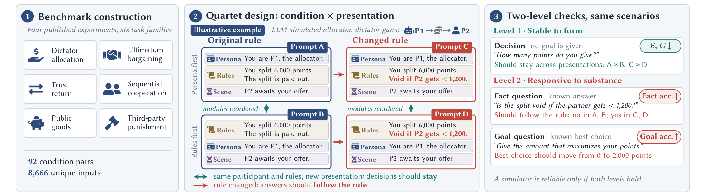
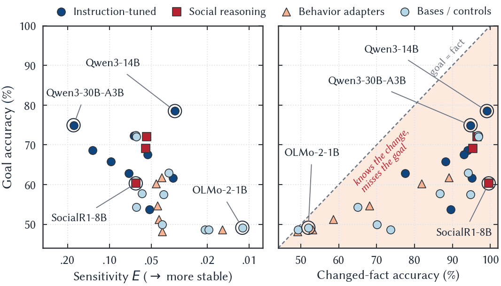
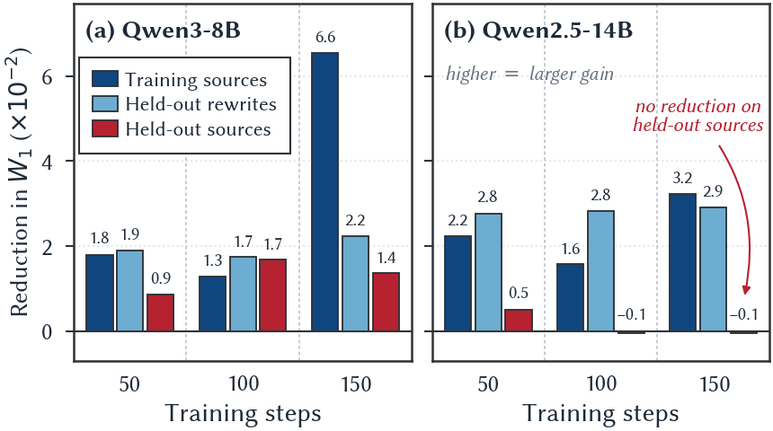

# INVAR: Stable to Form, Responsive to Substance

Code, benchmark data and key results for the paper
**"Stable to Form, Responsive to Substance: Evaluating Reliability in LLM-Based Simulation"** (under double-blind review).

- Project page: <https://anonymous.4open.science/w/invar-www27/>
- Anonymous code: <https://anonymous.4open.science/r/invar-www27/>

INVAR checks whether an LLM used as a simulated participant in a social-decision experiment
(1) keeps its decisions **stable** when only the presentation of a scenario changes, and
(2) **responds correctly** when a rule, permission, payoff or goal actually changes,
on the same scenarios.

| | |
|---|---|
| Source studies | 4 published social-decision studies with open materials |
| Task families | dictator allocation, ultimatum bargaining, trust return, sequential cooperation, public goods, third-party punishment |
| Condition pairs | 92 (14 kinds of change; 54 follow the original studies, 38 are extensions) |
| Quartets | 701 (two conditions x two equivalent presentations) |
| Unique inputs | 8,666 = 1,240 free decisions + 3,092 changed-fact + 2,888 unchanged-fact + 1,410 goal + 36 role questions |
| Language | Chinese prompts; English translation of a bilingual subset (32 pairs) |



*(a) Contrasts from four published studies in six task families become 92 condition pairs. (b) Each pair
yields a quartet: two rules × two equivalent presentations, each a separate call. (c) Decisions should
stay stable across presentations (E, G); fact and goal answers should follow the rule.*

## Key results

### RQ1: no configuration is both stable and goal-correct



Selected rows of Table 1 (reasoning off, pair-weighted; accuracies in %; the full table of 28 configurations
is in [`results/paper_tables/all_model_configurations.csv`](results/paper_tables/all_model_configurations.csv)
and on the project page):

| Model | E ↓ | G ↓ | Changed fact ↑ | Unchanged fact ↑ | Goal ↑ |
|---|---:|---:|---:|---:|---:|
| Qwen3-14B | .034 | .050 | 99.1 | 96.1 | **78.5** |
| Qwen3-30B-A3B | .181 | .213 | 94.8 | 95.8 | 74.9 |
| Qwen2.5-14B | .132 | .157 | 94.0 | 94.2 | 68.6 |
| GLM-4-9B | .035 | .038 | 95.1 | 88.9 | 61.6 |
| Llama-3.1-8B | .098 | .083 | 88.2 | 84.1 | 65.8 |
| Qwen3-8B (control) | .065 | .079 | 96.9 | 95.2 | 72.1 |
| ↳ SocialR1-8B | .065 | .076 | **99.6** | 92.6 | 60.3 |
| OLMo-2-1B (base) | **.011** | **.012** | 52.0 | 52.1 | 49.1 |
| ↳ Olmotaur-1B | .016 | .016 | 53.0 | 49.8 | 48.6 |

The most stable configurations answer fact and goal questions at chance level; strong fact accuracy
does not guarantee correct goal execution.

### RQ2: native reasoning (Table 2)

| Model | Setting | Goal off | Goal on | E off | E on | Valid off | Valid on |
|---|---|---:|---:|---:|---:|---:|---:|
| Qwen3-14B | pair-weighted | 78.0 | **99.99** | .023 | **.007** | 100.0 | 99.9 |
| | source-weighted | 73.3 | **99.87** | **.017** | .020 | | |
| | task-weighted | 74.2 | **99.92** | **.021** | .024 | | |
| Qwen3-30B-A3B | pair-weighted | 74.7 | **99.86** | .217 | **.010** | 100.0 | 98.4 |
| | source-weighted | 79.5 | **99.0** | .137 | **.023** | | |
| | task-weighted | 76.3 | **99.4** | .170 | **.023** | | |
| Qwen3-8B (bilingual subset) | Chinese | 71.6 | **99.2** | .039 | **.007** | 99.1 | 98.7 |
| | English | 73.6 | **99.4** | .053 | **.005** | 99.9 | 93.3 |
| SocialR1-8B (bilingual subset) | Chinese | 64.1 | **97.1** | **.071** | .108 | 97.7 | 82.7 |
| | English | 65.9 | **95.7** | **.099** | .141 | 99.3 | 88.2 |

Goal accuracy counts all attempts; E uses valid outputs (`tools/available_case_E.py`).

### RQ2: consistency fine-tuning (Table 3, Figure 3)

| Model | Training | E ↓ | G ↓ | Changed ↑ | Unchanged ↑ | Goal ↑ | E (source-wt.) ↓ |
|---|---|---:|---:|---:|---:|---:|---:|
| Qwen3-8B | Original | **.065** | .082 | **97.0** | **95.2** | 72.1 | **.049** |
| | SFT | .067 | .078 | 96.2 | 93.3 | 73.2 | .065 |
| | + consistency | .067 | **.072** | 95.7 | 93.9 | **73.5** | .059 |
| Qwen2.5-14B | Original | .132 | .159 | **94.0** | 94.2 | 68.4 | .088 |
| | SFT | .098 | .106 | 93.9 | 95.1 | 77.8 | **.079** |
| | + consistency | **.094** | **.101** | 93.8 | **95.6** | **78.1** | .080 |

Held-out-source fine-tuning with matched exposure (three-seed means; each row combines four adapters,
each tested on its unseen source).



The consistency term reduces discrepancy on training sources, less on held-out rewrites, and not
consistently on held-out sources.

## Repository layout

```
INVAR/
├── experiments/
│   ├── baseline_v2/INVAR_dataset/   # the benchmark: data, builders, evaluator, data card
│   ├── baseline_v2/                 # fact/goal checks, 8,666 inputs, generation + scoring (8 general models)
│   ├── social_cognition_v1/         # specialized models (behavior-prediction adapters, SocialR1, Socio) + bases
│   ├── shortpaper_20261111/         # Qwen3-14B / 30B-A3B main runs, goal discrimination, reasoning budgets
│   ├── confirmation_20261112/       # native reasoning off vs. on, all 92 pairs + 40 parametric pairs
│   ├── methods_v1/, methods_v2/     # helpers and the matched-exposure SFT / consistency (JS) trainer
│   ├── methods_v4/                  # held-out-source training: 2 models x 4 sources x 3 seeds
│   ├── mechanism_20261113_v2/       # checkpoint diagnostic of the consistency term (Figure 3)
│   └── robustness_20261115/         # bilingual / cross-family reasoning settings (Table 2, bottom)
├── results/
│   ├── paper_tables/                # accepted tables behind Tables 1-3 and Figures 2-3 (+ SHA provenance)
│   ├── supplement_20261111/         # goal discrimination, fact-goal pairing, native delivery, ...
│   ├── native_confirmation_20261112/# accepted behavior / goal / delivery tables and sampling statistics
│   ├── training_transfer_v4/        # per-source, per-seed training results
│   └── mechanism_20261113/          # per-checkpoint consistency-term diagnostic
├── paper/                           # make_figures.py regenerates Figures 2-3 and Tables 1-3
├── tools/build_writing_context.py   # builds results/paper_tables from the accepted run outputs
└── docs/                            # project page (GitHub Pages)
```

## The benchmark data

All benchmark files live in `experiments/baseline_v2/` (kept at their original paths so that every
frozen script still resolves them).

| File | Contents |
|---|---|
| `INVAR_dataset/data/prompts.jsonl` | 1,240 unique free-decision prompts; send only `messages` to the model |
| `INVAR_dataset/data/quartets.jsonl` | 701 quartets: prompt ids of A/B (original condition) and C/D (changed condition) |
| `INVAR_dataset/data/pairs.jsonl` | 92 condition pairs: source, intervention kind, adaptation notes |
| `INVAR_dataset/data/cases.jsonl` | 184 condition records: facts, action space and payoff table (for auditing; not sent to models) |
| `INVAR_dataset/controls/role_comprehension.jsonl` | 36 role-comprehension questions |
| `fact_quartets.jsonl`, `fact_checks.jsonl` | changed-fact and unchanged-fact questions with known answers |
| `goal_quartets.jsonl`, `goal_audit.jsonl` | goal questions; the correct answer is the full optimal action set |
| `inputs.jsonl` | all 8,666 unique model inputs with expected answers |
| `INVAR_dataset/DATA_CARD.md`, `INVAR_dataset/audit/` | data card, per-source rule audits, equivalence checks |
| `INVAR_dataset/provenance/sources.jsonl` | citations and links for the four source studies |

Third-party source materials (original papers, instructions, data files) are **not redistributed**;
`provenance/sources.jsonl` points to their public locations. Human choices are not used as correct
answers: free decisions are compared with each other, while fact and goal questions have known answers.

`experiments/robustness_20261115/frozen/` contains the bilingual subset (Chinese and English prompts),
and `experiments/confirmation_20261112/frozen/parameter/` the 40 parametric pairs whose two conditions
have disjoint optimal actions.

## Metrics

Let `p_X` be the distribution of normalized actions for prompt `X`, `mu_X` its mean and `W1` the
1-Wasserstein distance.

- **Presentation discrepancy** `E = 1/2 [W1(p_A, p_B) + W1(p_C, p_D)]` (lower = more stable)
- **Effect discrepancy** `G = |(mu_C - mu_A) - (mu_D - mu_B)|` (lower; `G <= 2E`)
- **Fact accuracy** on changed (Chg.) and unchanged (Unch.) facts, and **goal accuracy** over all attempts
  (invalid outputs count as errors; answers are never recovered from reasoning traces)

Scores are averaged within and then across pairs (pair-weighted); source- and task-weighted averages
are reported as sensitivity checks. Reference implementations: `INVAR_dataset/evaluate.py`
(`w1`, `normalize`, `parse_response`), `baseline_v2/score_v2.py`, and
`robustness_20261115/behavior_metrics.py`.

## Reproducing the paper's tables and figures (CPU only)

```bash
pip install numpy pandas matplotlib
cd paper
python make_figures.py
```

This reads only the accepted result tables in `results/` and rewrites `paper/tables/tab_*.tex`,
`paper/figures/fig2_scatter.pdf`, `paper/figures/fig3_training_bars.pdf` and `paper/numbers_used.txt`.
The regenerated tables are byte-identical to the ones in the submission. (Set `LIBERTINE_DIR` to a
Linux Libertine/Biolinum font folder to match the paper's typeface; otherwise a default font is used.)

| Paper item | Script | Data |
|---|---|---|
| Table 1, Figure 2 (28 configurations) | `paper/make_figures.py` | `results/paper_tables/all_model_configurations.csv`, `results/supplement_20261111/*goal_discrimination*.csv` |
| Table 2 top (reasoning off/on, 92 pairs) | same | `results/paper_tables/native_confirmation.csv`, `results/native_confirmation_20261112/accepted_delivery.csv` |
| Table 2 bottom (bilingual subset) | same | `experiments/robustness_20261115/results/summary_corrected.csv` |
| Table 3 (held-out-source training) | same | `results/paper_tables/training_summary.csv`, `results/training_transfer_v4/` |
| Figure 3 (checkpoint diagnostic) | same | `results/paper_tables/mechanism_checkpoint_means.csv`, `results/mechanism_20261113/` |

## Running models on INVAR (GPU)

The minimal pipeline needs only the standard library plus `vllm` for generation:

```bash
cd experiments/baseline_v2/INVAR_dataset
python make_run_plan.py --models my-model --tier all --repeats 32 --out runs/plan.jsonl
# send each prompt's `messages` in a fresh conversation, one call per plan row, and save raw outputs
python evaluate.py --help
python -m unittest discover -s tests       # CPU tests of the builder and evaluator
```

The full protocol used in the paper (structured JSON decoding restricted to legal actions,
temperature 0.7; 256 samples per free decision, 16 per goal question, 8 per fact question and
option order) is in `experiments/baseline_v2/run_structured.py` and `score_v2.py`; specialized
models use `experiments/social_cognition_v1/run_model.py`. Native-reasoning runs use
`experiments/confirmation_20261112/worker.py` and `score.py`; the bilingual settings use
`experiments/robustness_20261115/science_worker.py`, `score.py` and `rescore_terminal_v3_1.py`
(final v3 parser). Training uses `experiments/methods_v4/train_transfer.py` (LoRA rank 8; SFT on fact
and goal questions, with or without the consistency term defined in
`experiments/methods_v2/train_condition_anchor.py`), evaluated with `run_transfer_evaluation.py`,
`score_transfer.py` and `aggregate_transfer.py`.

Model paths in the scripts (e.g. `/workspace/models/...`) are placeholders for local copies of the
public Hugging Face checkpoints listed in the paper.

## Notes

- Every experiment folder is a snapshot of the code that was frozen and run; scripts are kept unchanged
  except that machine-specific paths were replaced by placeholders. Operational scripts (remote
  control, monitoring, synchronization) are omitted.
- Some protocol notes and summaries (`*.md`, `SUMMARY_zh.md`) are in Chinese, the language of the
  original prompts. The README files and this page describe everything needed to use the data.
- Raw model responses (millions of samples) and LoRA weights are not included because of their size.
- Limitations: all four sources were seen during development, so held-out results concern source
  exclusion rather than unseen sources; equivalent presentations were checked by programs and AI
  assistance, not yet by independent human reviewers; only open-weight models and single-decision
  calls are tested.

## License

Code: MIT. Benchmark data and results: CC BY 4.0. Rights in the original source studies remain with
their authors.
